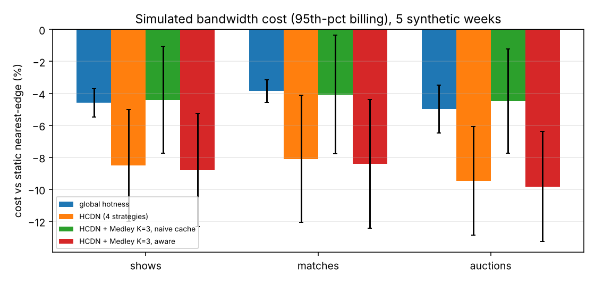
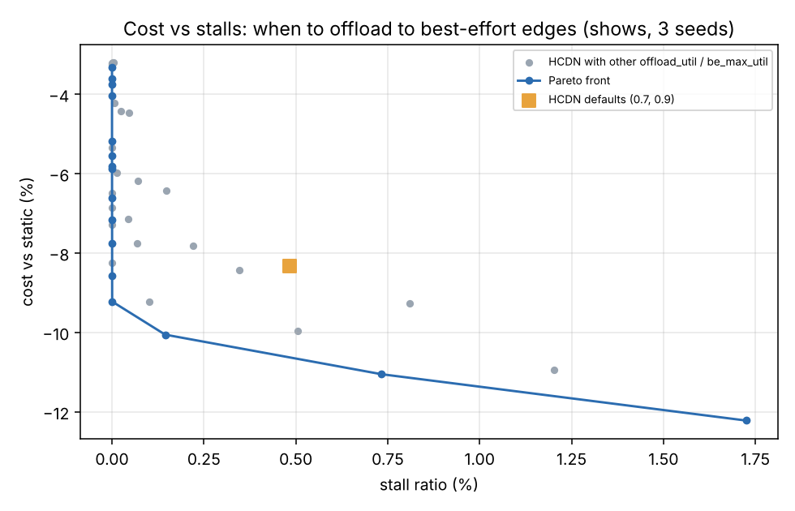

# LiveSched

A trace-driven simulator of a hierarchical live-streaming CDN, with
re-implementations of ByteDance's HCDN stream-scheduling strategies and
Medley-style substreams (both NSDI '26), three LIVE scenarios (shows,
LIVE Matches, countdown auctions), an LP lower bound, a Gym-style gRPC
environment with a Python client, a simulator-verified strategy search with a
held-out test split, an RL baseline, and a sandbox for strategies written as
code.

**Everything here is simulated.** The trace is synthetic (Twitch-like
popularity, regional audiences, diurnal load); topology, prices and
capacities are invented. Read the numbers as relative changes on identical
traces. Model and limits: [`docs/DESIGN.md`](docs/DESIGN.md). All tables:
[`results/SUMMARY.md`](results/SUMMARY.md).

## Results



**Baselines** (5 synthetic weeks of 12 hours, ~1M sessions each, 95% CIs):

| | cost vs static nearest-edge | midgress / egress | stall ratio |
|---|---|---|---|
| global hotness (prior approach) | -4.6% ± 0.9 | 0.103 | 0.16% |
| HCDN, four strategies | -8.5% ± 3.5 | 0.077 | 0.38% |
| HCDN without S4 (best-effort offload) | -4.3% ± 1.3 | 0.079 | 0.11% |

The ablations say most of HCDN's saving in this model comes from S4
(offloading hot streams to cheap best-effort edges at peak), and that S4 is
also where its stalls come from. Pre-connecting feed joins cuts median
startup from 240 ms to 100 ms.

**Substreams.** Medley-style K = 3 substreams without substream-aware caching
raise cost by 3.0% under static mapping, because a miss on any substream
pulls the full stream (the effect HCDN reports); with substream-aware caching
they save 2.2%.



**The cost/stall frontier.** Sweeping S4's two knobs shows the default
thresholds are dominated: offloading earlier (at 40% regional utilization)
but never filling a best-effort link past its guaranteed 60% floor gives
-9.2% cost at 0.000% stalls, against -8.3% at 0.48% for the defaults
(shows, 3 weeks).

**Auction cohort: latency vs cost** (auctions scenario, 5 weeks). Bidders
use a low-latency player with a 2.0 s glass-to-glass bound. Scenario-blind
scheduling is HCDN treating bidders like everyone else (best-effort offload,
cross-region consolidation); scenario-aware keeps them on regular in-region
edges.

| scheduling | transport | cost vs static | bidder g2g p95 | bidder g2g p99 | viewing time within 2.0 s |
|---|---|---|---|---|---|
| scenario-blind | whole streams | -9.7% ± 3.3 | 1,900 ms | 18,760 ms | 98.3% |
| **scenario-aware** | whole streams | -9.5% ± 3.4 | 1,790 ms | **1,790 ms** | **100.0%** |
| scenario-aware | Medley K = 3 | -9.8% ± 3.4 | 2,090 ms | 2,090 ms | 0.0% |
| scenario-aware | Medley K = 3, auction streams whole | -9.7% ± 3.4 | 1,790 ms | 1,790 ms | 100.0% |

Keeping bidders off best-effort and remote edges cut their p99 from 18.8 s
to 1.8 s for 0.2 points of cost. The tail is bidders on best-effort edges
that stall or lose their edge in an outage and fall behind live faster than
the player's 1.1x catch-up recovers. The p50 and p95 values are the model's
fixed latency components (capture 1.0 s, two relay hops, a 0.6 s buffer),
and the substream rows follow directly from the assumed 0.3 s reassembly
cost, which puts every bidder at 2.09 s. What carries over is the mechanism:
latency-critical streams have to travel whole.

**Strategy search** (80 candidates per run: 20 random, then mutation; 3
training weeks, top 8 re-checked on a validation week, winner tested on 3
held-out weeks per scenario; objective: minimum cost with stalls under 0.1%
of watch time and p95 startup within 25 ms of the reference). Five runs that
differ only in the proposer's seed, against HCDN with default thresholds:

| seed | shows | LIVE Matches | auctions | held-out stall, HCDN / winner | first candidate beating HCDN on training weeks |
|---|---|---|---|---|---|
| 1 | -5.6% | -5.1% | -5.2% | 0.71% / 0.75% | trial 2, 7 s |
| 2 | -5.4% | -4.4% | -5.1% | 0.71% / 1.00% | trial 10, 35 s |
| 3 | -1.9% | -2.3% | -1.8% | 0.71% / 1.04% | trial 24, 75 s |
| 4 | -5.0% | -4.5% | -4.5% | 0.71% / 0.99% | trial 7, 22 s |
| 5 | -6.1% | -5.5% | -5.9% | 0.71% / 1.00% | trial 2, 7 s |
| mean (95% CI) | -4.8% ± 2.1 | -4.4% ± 1.5 | -4.5% ± 2.0 | | median trial 7, 22 s |

Each search took 250-286 s of wall-clock time. Every winner offloads to
best-effort edges from 30-33% regional utilization (seed 3: 74%, hence its
smaller saving) and caps them at 61-65%, just above their guaranteed floor.

**The held-out weeks found a robustness problem.** Re-running each winner on
the test weeks one at a time:

| | week 21 (overloaded) stall | week 21 cost | weeks 22-23 stall | weeks 22-23 cost |
|---|---|---|---|---|
| HCDN defaults | 2.06% | | 0.024-0.037% | |
| seed 1 winner (S1 on) | 2.23% | -5.0% | 0.003% | -4.8 to -6.1% |
| seeds 2-5 winners (S1 off) | 2.95-3.13% | -2.6 to -6.1% | 0.000-0.022% | -1.5 to -6.2% |

On normal weeks every winner is cheaper with fewer stalls than HCDN. Week 21
is overloaded (static mapping reaches 134% regional utilization and 6.3%
stalls), and there the four winners that switched off S1 (frozen streams to
multihomed edges) stall 43-52% more than HCDN. No training or validation
week contains overload, so the stall SLO never saw it. The fix is a split
that includes an overload week in training or validation, or a worst-week
stall constraint; neither is in the reported runs. A first version of the
search, without random exploration, found nothing that survived validation;
that run is why the split exists.

**RL baseline over the gRPC environment** (a negative result). REINFORCE with
a linear softmax policy chose one of 12 settings of S4's two knobs every 5
simulated minutes from regional utilization and time of day, trained for 90
episodes on the search's training weeks (4.1 min per seed), 5 seeds:

| held-out scenario | RL cost vs HCDN defaults (mean ± 95% CI over seeds) | RL stall ratio (HCDN: 0.66 / 0.78 / 0.69%) |
|---|---|---|
| shows | +0.1% ± 3.1 | 0.67% |
| LIVE Matches | +0.7% ± 2.9 | 0.76% |
| auctions | +0.4% ± 3.0 | 0.69% |

It did not beat HCDN. Each seed's greedy policy collapsed to an almost
constant action: three seeds learned "never offload" (+1.5% to +1.6% cost),
one learned the search's region (offload from 33%, cap at 60%: -3.9%), and
one mixed the two (+1.3%). Likely reasons: the per-step reward uses
average-billing cost while the test metric bills the 95th percentile, so an
episode's cost is decided by a few peak intervals and per-step credit is
weak; and 90 episodes of a 12-action policy are few. The search scores whole
episodes and does not have the first problem.

**LP lower bound** (2-hour instance, average billing, ignores QoE): static
159%, HCDN 143%, seed-1 search winner 134% of the bound (120% if best-effort
capacity is derated to its floor).

**Simulator throughput**: one 12-hour week of the shows scenario under HCDN
(1,034,195 sessions, 16.4M viewer-minutes) in 1.93 CPU-seconds in one
process: **8.5M simulated viewer-minutes per CPU-second**, 32.1M sessions per
CPU-minute.

**Sandbox.** A candidate strategy runs as a separate process with no network,
CPU and memory limits and a per-call timeout. The test candidate
`strategies/examples/misbehaving.py` tries to open a socket (fails: network
unreachable) and then hangs; it is cut off and the run degrades to the
default edge instead of hanging the search.

## Quick start

```bash
go build -o bin/livesched ./cmd/livesched
go test ./...

./bin/livesched run -strategy hcdn -scenario matches            # one simulation
./bin/livesched run -strategy hcdn -substreams 3                 # with naive substreams
./bin/livesched run -external "python3 -I strategies/examples/cold_aggregate.py" -hours 1 -peak 5000
./bin/livesched search -budget 80 -stall-slo 0.001               # strategy search
./bin/livesched search -proposer llm -model-cmd "python3 my_model.py"   # any model behind a command
./bin/livesched serve -addr 127.0.0.1:50071 &                    # gRPC environment
python3 python/rl_baseline.py --addr 127.0.0.1:50071 --seed 1 --episodes 90 --out rl.json
bench/run_all.sh                                                 # everything in results/ (~55 min)
```

The environment (`env/proto/livesched_env.proto`) is Gym-shaped: `Reset`
starts an episode (one synthetic week of one scenario), `Step` applies an
action (HCDN's knobs for the next control interval) and returns per-region
utilization, the interval's cost rate, stalled share and the auction cohort's
latency, and `Close` returns the episode's true 95th-percentile-billing
metrics. `env/python/livesched_env.py` is the Python client.

Replay the public Twitch dataset (Rappaz et al., RecSys '21) instead of the
synthetic trace: download `100k_a.csv` from the dataset page, then
`./bin/livesched run -trace 100k_a.csv -trace-from 0 -hours 12`. The loader is
tested on a generated file in the same format (`livesched sample`); the real
file was not available where these results were produced.

## Layout

```
sim/             engine: topology, sessions, egress/midgress accounting, QoE, glass-to-glass latency, metrics, tests
strategies/      static, global hotness, HCDN (switchable S1-S4, scenario-blind variant), external (sandboxed policy as code)
workload/        synthetic trace, LIVE Match and auction overlays, Twitch dataset loader
search/          proposers (mutate, llm via a Model interface), train/validate/test driver
env/             gRPC environment: proto, Go server, generated Python client
python/          rl_baseline.py (REINFORCE), lpbound.py (SciPy HiGHS), plot.py
cmd/livesched/   run, sweep, grid, search, serve, demand, sample
results/         SUMMARY.md, figures, raw JSON lines
docs/DESIGN.md   model, strategies, checks against the papers, validity threats, interview notes
```

## What is not here

- Real traces: Twitch and Puffer data could not be downloaded in the build
  environment. The loader exists; Puffer-based player calibration does not.
- A model-driven code-search run: the `llm` proposer, the policy-as-code
  sandbox and the `Model` interface are in place, but no model was available,
  so every search result above comes from the `mutate` proposer over HCDN's
  parameters.
- A search split with an overload week in training or validation (see the
  robustness finding above).
- NetAssistant-style incident diagnosis (stretch).

## Resume bullets (simulation results; keep the word "simulated")

- Built LiveSched, a trace-driven live-CDN simulator in Go (gRPC environment,
  Python client) that re-implements ByteDance's HCDN redirection strategies and
  Medley substreams (NSDI '26) across shows, LIVE Matches and countdown
  auctions, replaying 32M simulated viewer sessions per CPU-minute.
- Built a simulator-verified strategy search (train, validation and held-out
  weeks; sandboxed policy-as-code; pluggable model interface) whose winners cut
  simulated bandwidth cost 4.4-4.8% against re-implemented HCDN defaults on
  held-out weeks (mean of 5 search seeds; the seed-1 winner at 134% of an LP
  lower bound), and caught through per-week testing that 4 of 5 winners
  stalled 43-52% more than HCDN in an overloaded week; a REINFORCE baseline over the same environment did not
  beat HCDN (+0.1% to +0.7%).
- Modelled LIVE shows, LIVE Matches and auction scenarios with separate QoE
  objectives; scenario-aware scheduling cut the auction cohort's simulated p99
  glass-to-glass latency from 18.8 s to 1.8 s (100% of viewing time within the
  2.0 s bound, vs 98.3%) for 0.2 points of cost.
- Reproduced the papers' directional findings (substream cache misses
  amplify internal traffic; aggregation cuts midgress/egress from 0.18 to
  0.08) and showed HCDN's best-effort offload trades stalls for cost: capping
  best-effort links at their guaranteed floor kept the saving (-9.2% vs
  static) with zero simulated stalls.

## Interview defence

`docs/DESIGN.md` section 8: why flow-level, how the simulator was checked
without ByteDance data, how the search is kept from overfitting (and where it
still did), why HTTP redirection, and why the RL baseline lost.
